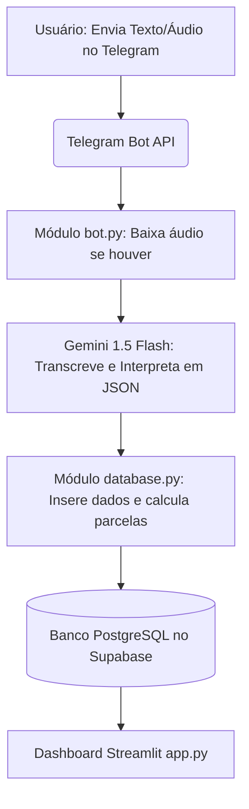

# 🤖 FinBot — Assistente Financeiro Compartilhado e Inteligente

O **FinBot** é uma aplicação de finanças pessoais e compartilhadas com o objetivo de oferecer extrema praticidade de uso. O usuário envia uma mensagem de texto ou áudio no Telegram, o sistema interpreta o gasto/receita/parcela usando a Inteligência Artificial do **Gemini 1.5 Flash**, salva em um banco de dados relacional **Supabase (PostgreSQL)** e exibe tudo em um **Dashboard Streamlit** dinâmico e responsivo.

Toda a arquitetura é baseada em tecnologias open-source e com camadas gratuitas (Zero Cost).

---

## 🚀 Como Funciona o Fluxo?


---

## 🛠️ Requisitos de Configuração

### 1. Configurando o Bot no Telegram
1. No Telegram, procure pelo bot oficial `@BotFather`.
2. Envie o comando `/newbot` e siga as instruções para dar um nome e um nome de usuário (username) ao seu bot.
3. Copie o **Token de Acesso HTTP API** (ex: `123456789:ABCdefGhIJKlmNoPQRsTUVwxyZ`). Esse token será a sua variável `TELEGRAM_TOKEN`.

### 2. Configurando o Banco de Dados no Supabase
1. Crie uma conta gratuita em [Supabase.com](https://supabase.com/).
2. Crie um novo projeto.
3. Após criar o projeto, vá em **SQL Editor** no painel lateral esquerdo, clique em "New Query", cole o conteúdo do arquivo [schema.sql](schema.sql) e clique em **Run**. Isso criará as tabelas `usuarios`, `categorias`, `transacoes` e `dividas` com as devidas restrições e índices.
4. Vá em **Project Settings** > **API** e copie os seguintes campos:
   - **Project URL** (ex: `https://xxxx.supabase.co`) -> `SUPABASE_URL`
   - **API Key** (chave `anon` ou `service_role`) -> `SUPABASE_KEY`

### 3. Configurando a API do Gemini
1. Vá até o [Google AI Studio](https://aistudio.google.com/).
2. Clique em **Get API Key** e crie uma nova chave de API gratuita.
3. Copie o token gerado. Esse token será a sua variável `GEMINI_API_KEY`.

---

## 📁 Estrutura de Arquivos do Projeto
- [requirements.txt](requirements.txt): Todas as dependências necessárias de Python.
- [config.py](config.py): Módulo que carrega e valida o arquivo `.env`.
- [schema.sql](schema.sql): Script SQL para estrutura do banco de dados relacional.
- [database.py](database.py): Funções de inserção, busca de transações simples/parceladas, dívidas e consultas consolidadas.
- [bot.py](bot.py): Lógica do bot de Telegram integrado à inteligência artificial multimodal (Gemini).
- [app.py](app.py): Interface do Dashboard Analítico construído com Streamlit.

---

## 💻 Executando a Aplicação Localmente

### Passo 1: Clone o Repositório e Prepare o Ambiente
Abra o terminal na pasta raiz do projeto e crie um ambiente virtual do Python:
```bash
python -m venv venv
# Ative o ambiente virtual:
# No Windows (PowerShell):
.\venv\Scripts\Activate.ps1
# No Linux/Mac:
source venv/bin/activate
```

### Passo 2: Instale as Dependências
Execute a instalação das bibliotecas requeridas:
```bash
pip install -r requirements.txt
```

### Passo 3: Configure as Variáveis de Ambiente
Crie um arquivo chamado `.env` na raiz do seu projeto e preencha-o com as credenciais obtidas nos passos anteriores:
```env
TELEGRAM_TOKEN=seu_telegram_token_aqui
SUPABASE_URL=https://sua_url_do_supabase.supabase.co
SUPABASE_KEY=sua_chave_de_api_anon_do_supabase
GEMINI_API_KEY=sua_chave_de_api_do_gemini_aqui
```

### Passo 4: Executar o Bot de Telegram
Em uma janela de terminal com o ambiente virtual ativado, rode:
```bash
python bot.py
```
O console exibirá que o bot foi iniciado com sucesso. Vá até o seu bot no Telegram e envie o comando `/start`. Experimente mandar mensagens de voz ou texto!

### Passo 5: Executar o Dashboard Streamlit
Em uma segunda janela de terminal com o ambiente virtual ativado, rode:
```bash
streamlit run app.py
```
O Streamlit abrirá uma nova guia no seu navegador (normalmente em `http://localhost:8501`) exibindo o dashboard analítico financeiro!

> **Dica de Teste:** O dashboard possui um **Modo Simulado** na barra lateral. Caso queira testar a interface imediatamente sem cadastrar chaves no `.env` ou sem transações no banco, você pode marcar a opção "Visualizar dados simulados (Test Drive)" para visualizar a interface completamente populada de despesas, receitas, gráficos de cashflow e parcelamentos.

---

## 📈 Recursos e Regras de Negócio Implementados
- **Transações Simples:** Registra despesas (valores negativos) e receitas (valores positivos).
- **Cartão de Crédito e Parcelamentos:** Compras identificadas como parceladas geram registros divididos de forma igualitária e distribuídos ao longo das datas de competência dos meses futuros de forma automática.
- **Controle de Dívidas:** Permite gerenciar valores que deve a terceiros, controle de pagamentos parciais e status de quitação.
- **Metas de Categorias:** Se o gasto acumulado de uma categoria ultrapassar a meta mensal estipulada em `categorias.meta_mensal`, o dashboard emite um alerta visual na tela.
- **Multi-usuário:** O sistema reconhece cada participante pelo ID único do Telegram, permitindo filtrar o dashboard por usuário individual ou analisar o total acumulado do grupo.
